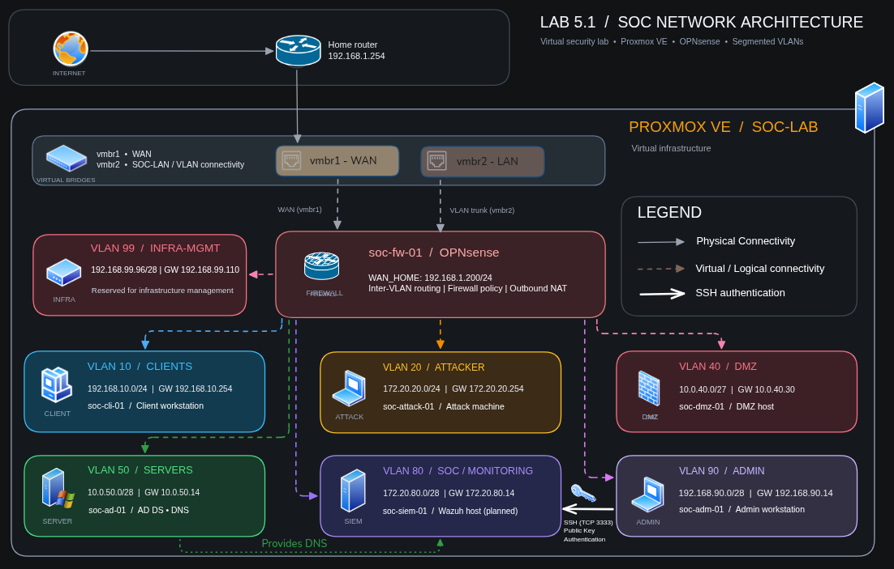

# SOC Lab – Network Security & Monitoring

A virtual lab focused on network administration, defensive security and security monitoring.

Hosted on **Proxmox VE**, the environment uses **OPNsense** for routing, firewalling and network segmentation. It integrates security tools such as **Suricata** for intrusion detection and prevention (IDS/IPS) and **Wazuh** for security monitoring and log analysis.

The project is organised into independent labs, each covering a specific aspect of the infrastructure and its security capabilities.

## Network architecture



## Labs

| Lab | Subject | Status |
|---|---|---|
| [5.1 – Network Architecture & Infrastructure](labs/5.1-network-architecture/README.md) | Virtual infrastructure, VLANs, routing and basic service validation | Completed |
| 5.2 – Suricata IDS on OPNsense | Network intrusion detection and alert validation | Next |

See [ROADMAP.md](ROADMAP.md) for the current scope.

## Repository structure

```text
.
├── README.md
├── ROADMAP.md
├── .gitignore
└── labs/
    └── 5.1-network-architecture/
        ├── README.md
        ├── architecture.png
        ├── configs/
        │   ├── netplan/
        │   └── ssh/
        └── evidence/
```

Each lab contains its own documentation, configuration examples and supporting evidence.
