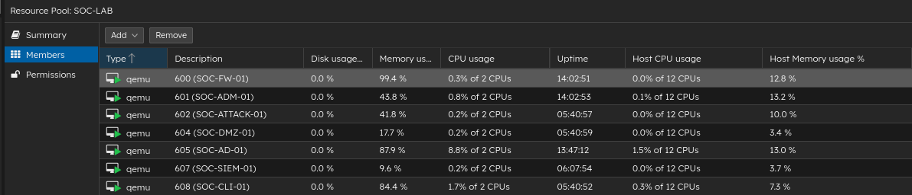
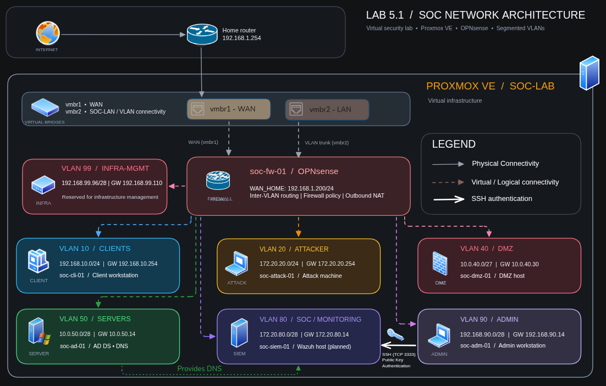
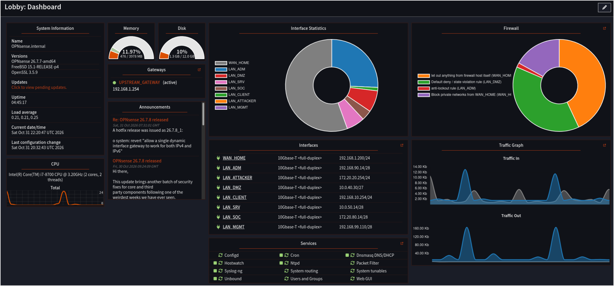
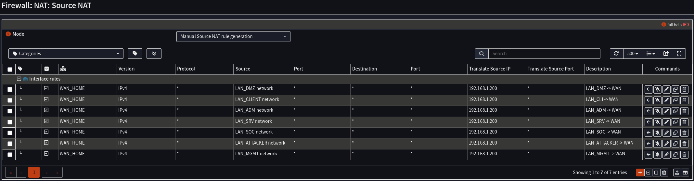
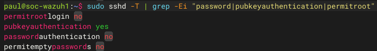
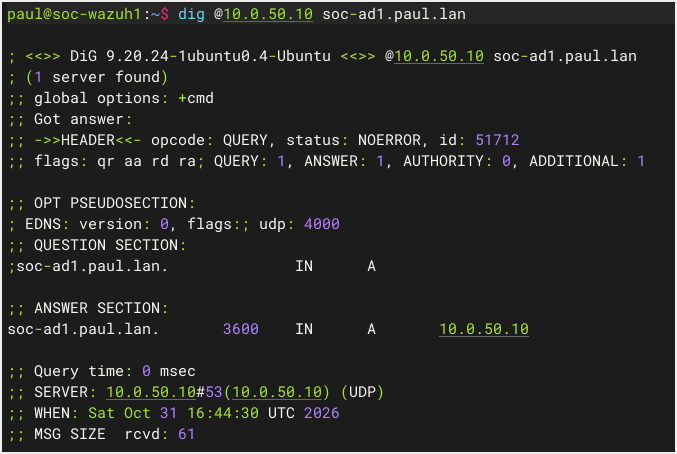
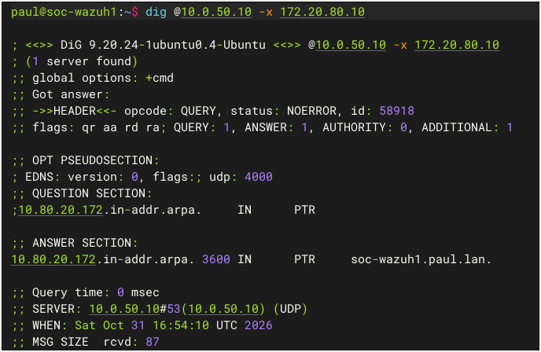
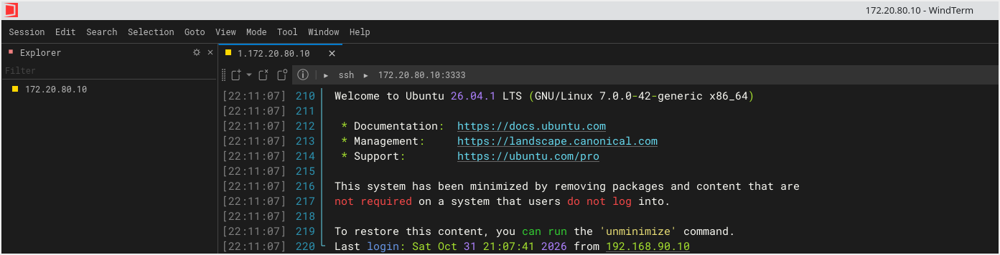

# Lab 5.1 – Network Architecture & Infrastructure

**Status:** Completed  

Lab 5.1 establishes the virtual network foundation for the SOC environment. It covers the Proxmox infrastructure, network segmentation, routing through OPNsense, and the basic services required to administer and validate the environment.

## Table of Contents

- [Infrastructure](#infrastructure)
- [Network Architecture](#network-architecture)
- [IP Addressing](#ip-addressing)
- [Implementation](#implementation)
- [Verification](#verification)
- [Challenges & Troubleshooting](#challenges--troubleshooting)
- [Takeaways](#takeaways)

## Infrastructure

The lab is hosted on Proxmox VE. The virtual machines are separated by role, with OPNsense providing routing and firewalling between the lab networks.

| Component | Role |
|---|---|
| Proxmox VE | Hypervisor |
| OPNsense (`soc-fw-01`) | Firewall and router |
| Windows Server (`soc-ad-01`) | Active Directory and DNS |
| Ubuntu Server 26.04.1 (`soc-siem-01`) | SOC / Monitoring server |
| Debian with GUI (`soc-adm-01`) | Administration workstation |
| Kali Linux (`soc-attack-01`) | Attack simulation workstation |
| Debian Server (`soc-dmz-01`) | DMZ host |
| Windows 11 (`soc-cli-01`) | Client workstation |

The Proxmox inventory below shows the virtual machines deployed for this lab.

## Network Architecture

The network is divided into VLANs according to the role of each environment. OPNsense acts as the central router and firewall, controlling inter-VLAN traffic and providing outbound connectivity through the home network.

### IP addressing

| VLAN | Name | Network | Gateway |
|---:|---|---|---|
| 10 | CLIENTS | `192.168.10.0/24` | `192.168.10.254` |
| 20 | ATTACKER | `172.20.20.0/24` | `172.20.20.254` |
| 40 | DMZ | `10.0.40.0/27` | `10.0.40.30` |
| 50 | SERVERS | `10.0.50.0/28` | `10.0.50.14` |
| 80 | SOC / MONITORING | `172.20.80.0/28` | `172.20.80.14` |
| 90 | ADMIN | `192.168.90.0/28` | `192.168.90.14` |
| 99 | INFRA-MGMT | `192.168.99.96/28` | `192.168.99.110` |

## Implementation

### OPNsense

OPNsense provides the layer 3 gateways for the lab VLANs. Its WAN interface, `WAN_HOME`, uses the static address `192.168.1.200/24` on the home network, with `192.168.1.254` as the upstream gateway.

Outbound source NAT is configured manually. Traffic from the internal VLANs is translated to the OPNsense WAN address when leaving through `WAN_HOME`.

**Manual outbound NAT configuration:**

### Network Configuration

The SOC server (`soc-siem-01`) uses Netplan to configure its network interface with a static IP address, DNS resolver and default gateway.

Configuration: [01-network.yaml](configs/netplan/01-network.yaml)

### Administration access

The administration workstation (`soc-adm-01`) is used to manage the lab systems. Remote access to the SOC server is provided over SSH on TCP port `3333`.

SSH is configured for public-key authentication, with password authentication and root login disabled. The effective daemon configuration was checked with `sshd -T`.

Configuration: [sshd_config](configs/ssh/sshd_config)

### DNS

The Active Directory server at `10.0.50.10` provides internal DNS for the `paul.lan` domain. The SOC server uses this address as its DNS resolver.

Forward and reverse lookups were checked to confirm name resolution for the internal systems.

## Verification

The following checks were used to verify the main services configured in this lab:

- **DNS:** forward lookup of the Active Directory server and reverse lookup of the SOC server address (`172.20.80.10`).
- **SSH:** successful remote connection to the SOC server from the administration workstation using WindTerm.
- **SSH hardening:** confirmation of the effective SSH daemon settings.
- **Outbound NAT:** verification of outbound connectivity from internal VLANs.

## Challenges & Troubleshooting

- **SSH configuration management**

Configuring SSH hardening required investigating how OpenSSH loads and applies its configuration. Additional configuration files under sshd_config.d/ affected the effective settings, making it necessary to inspect the included files and verify the   final configuration using sshd -T.

- **Network profile configuration**

Switching the administration workstation from a temporary WAN connection to the internal LAN connection caused unexpected network configuration issues. The existing connection profile was still being applied, preventing the new configuration   from taking effect. After investigating the network configuration files under `/run/`, the issue was identified through the graphical network manager, where the incorrect profile was still active.

- **Outbound NAT configuration**

Internal VLANs initially lacked proper outbound connectivity due to an incorrect interface assignment in the outbound NAT rules. Reviewing the source translation and correcting the interface to `WAN_HOME` resolved the issue.

## Takeaways

This lab provided practical experience with virtual network design, VLAN segmentation, firewall routing and secure remote administration. It also highlighted the importance of validating network configurations and troubleshooting connectivity issues systematically.

## Next step

## Next step

**Lab 5.2 – Suricata IDS/IPS on OPNsense:** configure network intrusion detection and prevention, integrate rule sets and custom signatures, and validate alert generation and traffic blocking using controlled test traffic.

## Credits

Architecture diagram created with Excalidraw.
Some icons are based on shapes from draw.io (diagrams.net).
