# Lab 5.2 – Suricata IDS/IPS on OPNsense


**Status:** In progress

Lab 5.2 adds network intrusion detection and prevention to the SOC environment using Suricata on OPNsense. The lab covers IPS configuration, rule sources, custom signatures and controlled tests to verify alert generation and traffic blocking.

## Table of Contents

- [Suricata Configuration](#suricata-configuration)
- [Detection Rules](#detection-rules)
- [Security Testing](#security-testing)
- [Logging](#logging)
- [Challenges and Troubleshooting](#challenges-and-troubleshooting)
- [Takeaways](#takeaways)

## Suricata Configuration

Suricata is integrated into OPNsense and configured to run in **Netmap IPS mode**. The monitored interfaces and `HOME_NET` variable were configured to cover the protected lab networks while excluding the attacker network.

`HOME_NET` identifies the networks considered protected by Suricata rules. This classification affects how rules using `$HOME_NET` and `$EXTERNAL_NET` match traffic. The attacker network was therefore excluded to allow external-to-internal detection rules to identify traffic generated by Kali Linux.

`HOME_NET` does not define firewall permissions or automatically make traffic from protected networks trusted.

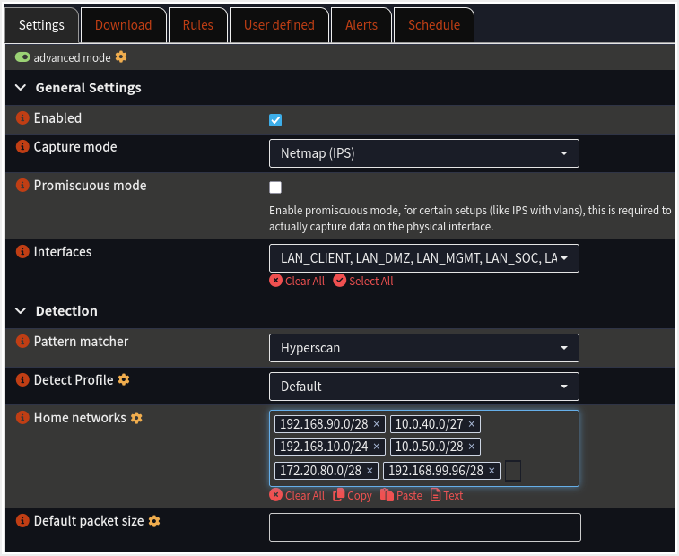

### Traffic Inspection Flow

The diagram below illustrates how Suricata inspects network traffic and applies the action defined by a matching rule.

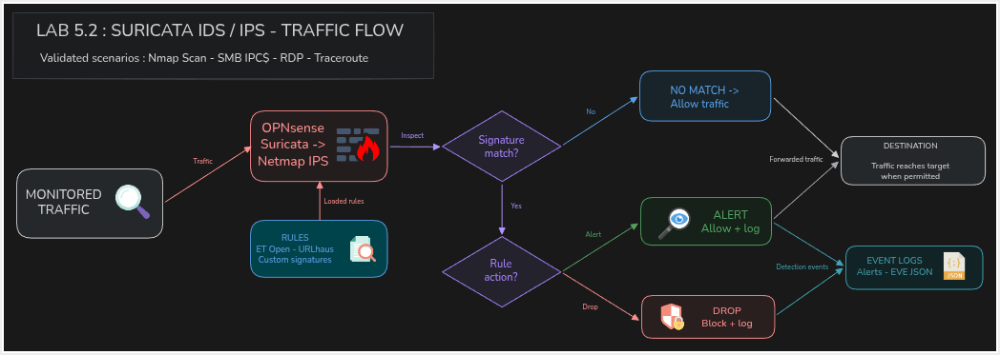

## Detection Rules

### Rule Sources

The following sources were enabled in OPNsense to provide detection coverage for different types of network activity.

| Rule source | Purpose |
|---|---|
| abuse.ch / URLhaus | Detection of known malicious URLs |
| ET Open / Emerging DNS | Detection of suspicious DNS activity |
| ET Open / Emerging Exploit | Detection of exploit attempts |
| ET Open / Emerging Malware | Detection of malware-related activity |
| ET Open / Emerging Scan | Detection of network scanning activity |
| ET Open / Emerging Shellcode | Detection of shellcode-related activity |

### Custom Rules

Three local signatures were added to cover specific traffic observed during the lab:

- **Traceroute:** detects the ICMP packet type observed during the traceroute test.
- **SMB IPC$ access:** detects access to the IPC$ share on the Windows Server.
- **RDP:** detects RDP traffic to the Windows client.

The rules are available in [`custom.rules`](rules/custom.rules). They were deployed on OPNsense at `/usr/local/etc/suricata/rules/custom.rules`.

All three custom rules use the `alert` action. During controlled IPS tests, selected Nmap signatures and the custom RDP signature were temporarily configured with the `Drop` action to validate traffic blocking.

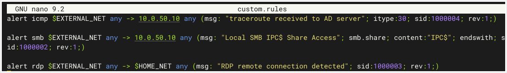

## Security Testing

Controlled traffic was generated from the Kali Linux VM to validate the configured signatures and IPS behaviour.

### Nmap Scan

A TCP SYN scan was run against the Windows Server:

```bash
nmap -sS 10.0.50.10
```

Suricata generated alerts for the scan. Selected Nmap signatures were temporarily changed to `Drop` to validate IPS blocking. The scan then reported the ports as filtered, and the corresponding blocked events were visible in Suricata.

**Kali – Nmap scan:**

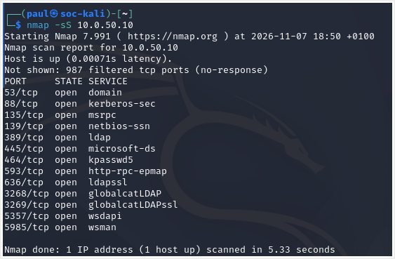

**Suricata – Detection alerts:**

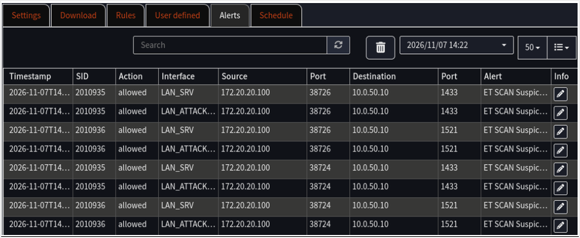

**Kali – Scan after IPS blocking:**

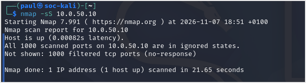

**Suricata – Blocked events:**

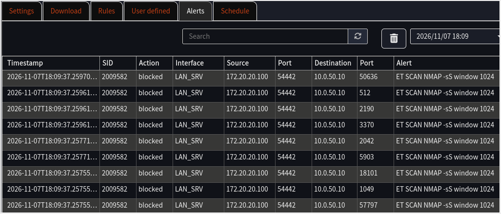

### SMB IPC$ Access

SMB share enumeration was performed from Kali Linux using `smbmap`. The custom signature generated an alert when access to the IPC$ share was observed.

This event is an indicator of SMB share access; by itself, it does not prove that every form of SMB enumeration has occurred.

**Kali – SMB share enumeration:**

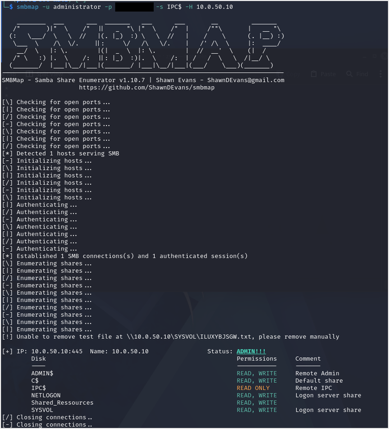

**Suricata – SMB IPC$ alert:**

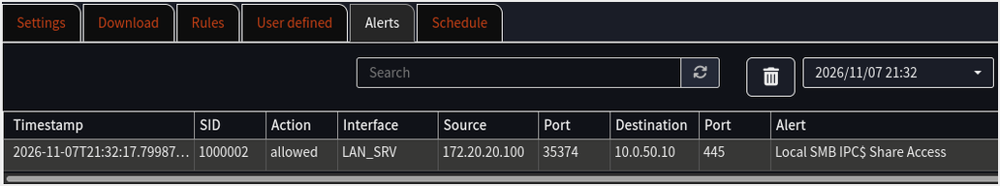

### RDP Traffic

An RDP connection attempt from Kali Linux was used to validate the custom RDP signature. The signature was temporarily configured with the `Drop` action, and Suricata recorded the resulting blocked events.

**Suricata – RDP blocked events:**

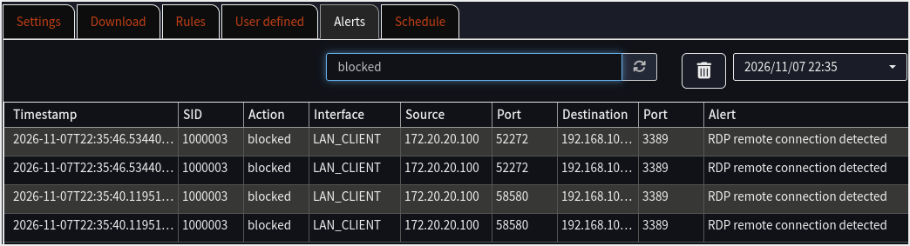

**Kali – Remmina connection failure:**

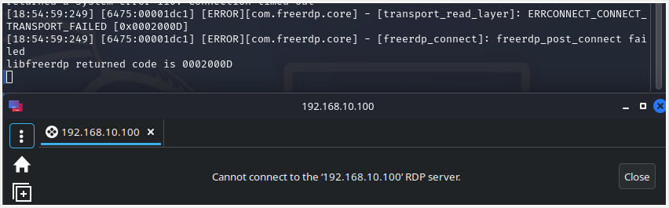

The connection attempt failed after Suricata blocked the RDP traffic. The FreeRDP transport error and Remmina connection failure are consistent with the IPS blocking the connection.

The custom RDP rule was returned to `Alert` after the test.

## Logging

Suricata events are available through the OPNsense Alerts interface and in the EVE JSON log:

```text
/var/log/suricata/eve.json
```

The event details include information such as the matching signature, source and destination addresses, monitored interface and action taken.

The EVE JSON log also provides a structured source of security events for future integration with Wazuh.

## Challenges and Troubleshooting

### HOME_NET and rule matching

Some detection rules initially failed to match traffic generated by Kali Linux.

The investigation revealed that the attacker network was included in HOME_NET, preventing rules expecting $EXTERNAL_NET-to-$HOME_NET traffic from matching as intended.

Excluding the attacker network from HOME_NET resolved the issue.

### Custom rule deployment

Adding a signature to the local rules file does not automatically mean that Suricata is using it. After editing `custom.rules`, the IDS configuration had to be reloaded:

```bash
configctl ids reload
```

The rules were then checked in the OPNsense interface to verify that they had been registered correctly before testing them.

### SMB signature matching

The SMB signature needed to inspect the share name, so `smb.share` was used to match `IPC$`.

The `smb.named_pipe` field refers to a different SMB element and would not have matched the intended traffic.

### IDS detection vs IPS blocking

An alert does not necessarily mean that traffic has been blocked. During the Nmap and RDP tests, selected signatures were temporarily configured with the `Drop` action to verify IPS enforcement.

The resulting blocked events confirmed that the prevention mechanism was working. The signatures were subsequently returned to `Alert` to avoid leaving the lab in a restrictive configuration.

## Takeaways

This lab provided practical experience with Suricata as a network IDS/IPS, from configuring inspection interfaces and selecting rule sources to writing custom signatures.

The tests demonstrated how network activity generated from Kali Linux can be detected and selectively blocked by Suricata. They also highlighted the importance of validating signatures against actual traffic and distinguishing between an alert and a blocking action.

## Next Step

**Lab 5.3 – Wazuh SIEM:** deploy a centralised security monitoring platform, integrate lab systems for security event collection, and configure event analysis and alerting.

## Credits

The Suricata traffic-inspection flow diagram was created with [diagrams.net (draw.io)](https://www.diagrams.net/).
