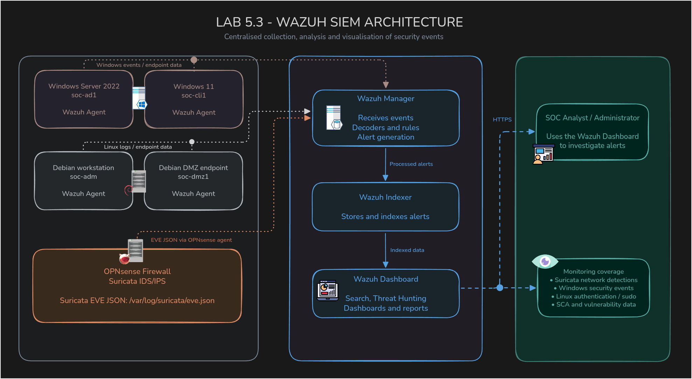
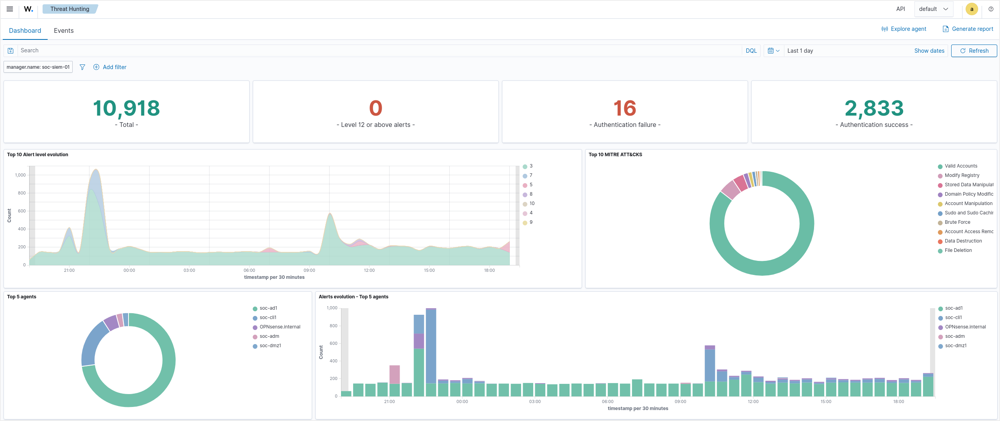
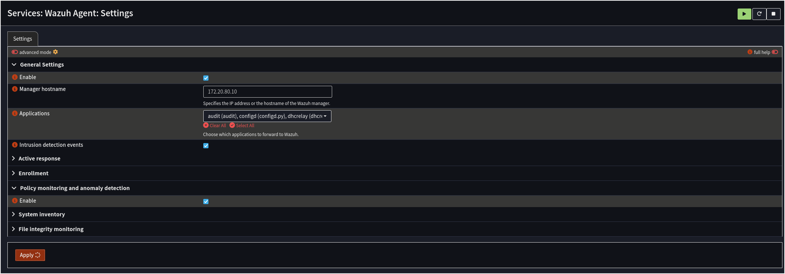
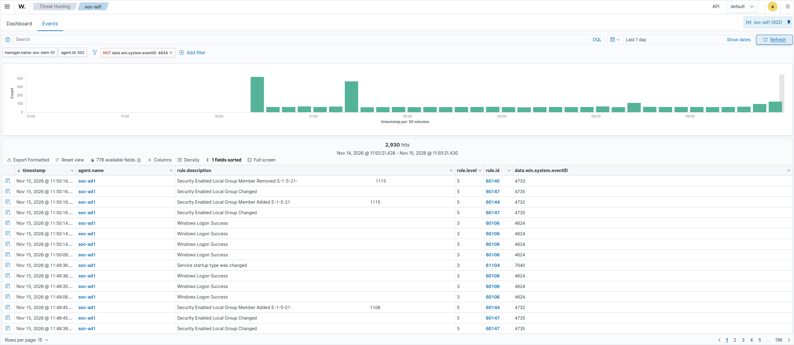
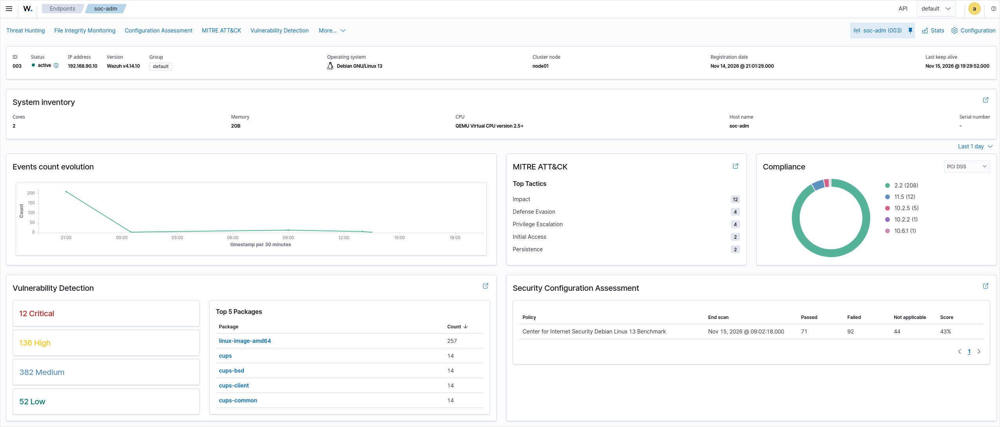
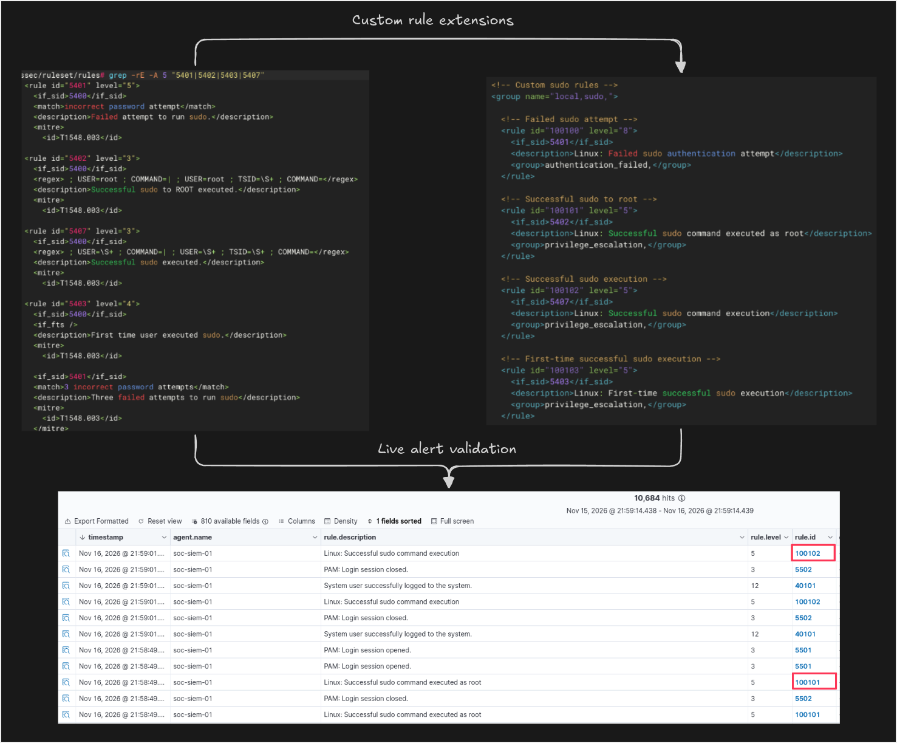
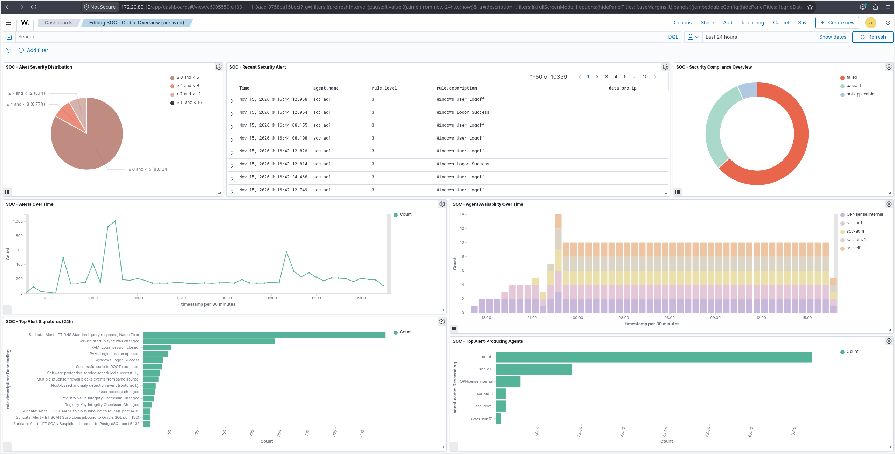
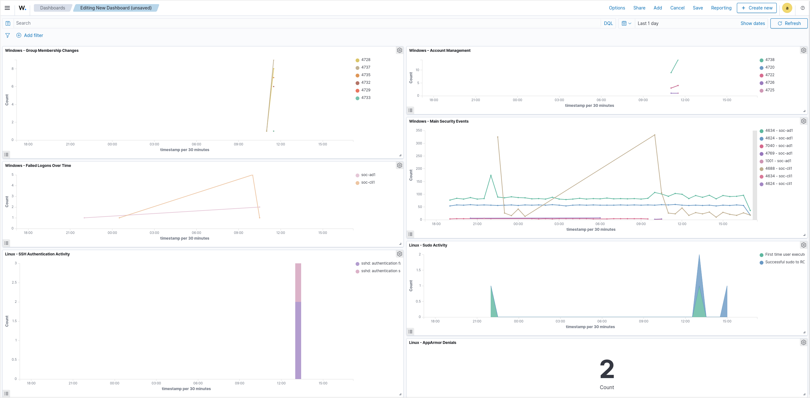
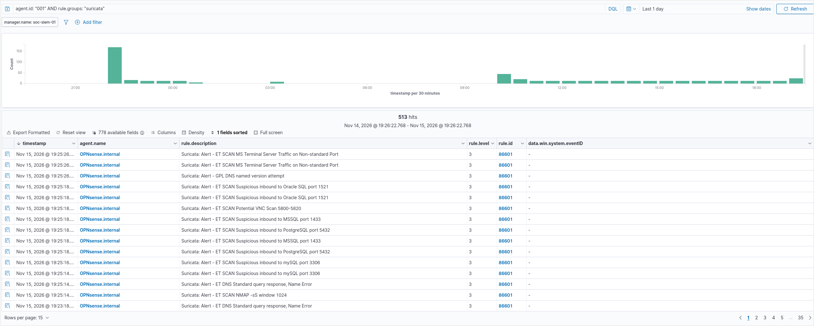
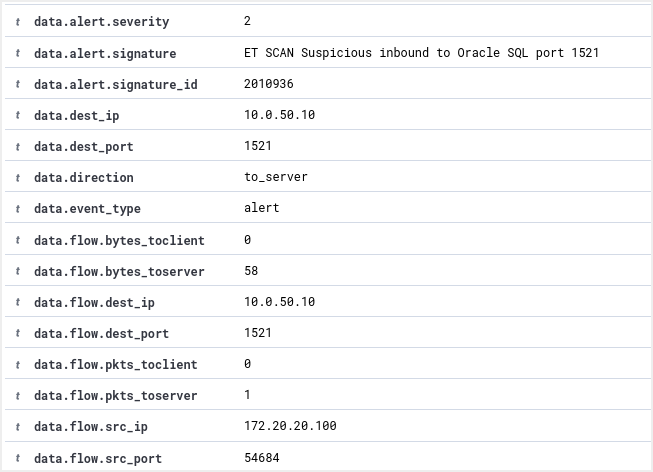

# Lab 5.3 – Wazuh SIEM


**Status:** Completed

Lab 5.3 adds centralised security monitoring to the SOC environment using Wazuh. The platform collects events from selected lab systems, analyses them through its manager, and makes alerts and monitoring data available through the dashboard.

## Table of Contents

- [Architecture](#architecture)
- [Wazuh Deployment](#wazuh-deployment)
- [Event Sources and Integration](#event-sources-and-integration)
- [Custom Rules](#custom-rules)
- [Monitoring and Dashboards](#monitoring-and-dashboards)
- [Validation](#validation)
- [Challenges and Troubleshooting](#challenges-and-troubleshooting)
- [Takeaways](#takeaways)
- [Next Step](#next-step)

## Architecture

The Wazuh deployment uses three main components hosted on the SOC server: the Manager, Indexer and Dashboard. Agents installed on monitored systems forward endpoint events to the Manager, while the Wazuh agent on OPNsense forwards Suricata events to the same Manager.



**The processing flow is straightforward:**

1. Agents collect events from monitored systems.
2. The Wazuh Manager receives events, applies decoders and rules, and generates alerts.
3. The Wazuh Indexer stores and indexes alert data.
4. The Wazuh Dashboard provides search, investigation and visualisation.

## Wazuh Deployment

Wazuh 4.14.10 was deployed on the Ubuntu Server SOC host (`soc-siem-01`) using the all-in-one installation. The deployment includes the Wazuh Manager, Wazuh Indexer and Wazuh Dashboard.

The dashboard is accessible over HTTPS from the administration workstation.



## Event Sources and Integration

Wazuh agents were deployed on the selected Windows and Linux endpoints. OPNsense was connected using its Wazuh agent plugin.

### OPNsense and Suricata

The OPNsense agent communicates with the Wazuh Manager at `172.20.80.10`. It is configured to collect Suricata EVE JSON events from:

```text
/var/log/suricata/eve.json
```

This integration makes network detections generated by Suricata available for centralised investigation in Wazuh.



### Windows endpoints

Windows event collection was enabled on the Windows Server and Windows 11 systems. The collected security events include account and group-management activity, providing visibility into changes affecting user and group membership.



### Linux endpoints

Linux agents collect relevant system and authentication activity, including SSH authentication and sudo-related events.

The Debian administration workstation (`soc-adm`) also provides host-level information through the Wazuh endpoint view, including system inventory, MITRE ATT&CK activity and vulnerability detection.



## Custom Rules

Local Wazuh rules were added to improve the visibility of sudo activity. They extend the built-in rules with custom descriptions, severity levels and classifications, covering failed sudo authentication and successful sudo execution events.

The configuration is maintained in [`configs/local_rules.xml`](configs/local_rules.xml). It also retains the original example SSH rule.



Rules `100101` and `100102` were successfully validated through live sudo activity, while rules `100100` and `100103` were tested using `wazuh-logtest`.

## Monitoring and Dashboards

Two dashboards were created to provide different views of the monitored environment.

### SOC – Global Overview

The global dashboard brings together alert severity, recent alerts, alert trends, agent availability and top alert signatures. It provides a general view of activity across the monitored environment.




### SOC – Endpoint Monitoring Overview

The endpoint dashboard focuses on Windows and Linux activity, including Windows account and group changes, failed logons, Linux SSH authentication, sudo activity and AppArmor denials.



## Validation

A key objective of this lab was to verify that network detections generated by Suricata could be collected and investigated centrally through Wazuh.

The validation followed the event path from OPNsense to the SIEM. In Wazuh Threat Hunting, the results were filtered for the OPNsense agent (`OPNsense.internal`) and Suricata-related rule groups.

The results showed ET SCAN alerts alongside other Suricata DNS-related detections, with 513 matching events over the displayed 24-hour period. This confirmed that network security events were being forwarded to Wazuh and were available for investigation.



### Investigating an individual detection

To verify that the collected events contained useful investigative information, an individual alert was opened.

The selected event is an ET SCAN detection for suspicious inbound traffic targeting Oracle SQL on port `1521`. Its details identify:

- **Source address:** `172.20.20.100`
- **Destination address:** `10.0.50.10`
- **Destination port:** `1521`
- **Detection source:** Suricata / Emerging Threats

The event details provide additional context beyond the signature description and make it possible to identify the systems involved and the service targeted.



## Challenges and Troubleshooting

### Windows event volume

Enabling Windows event collection, particularly on the domain controller, generated a substantial amount of data.

The collection settings were adjusted to focus on account and group-management events relevant to the lab, avoiding unnecessary event volume.

### Dashboard certificate

The Wazuh dashboard used an internal certificate authority. Although the CA certificate was added to the Debian administration workstation's trust store, the browser continued to display a certificate warning.

The issue was caused by a mismatch between the hostname used to access the dashboard and the name included in its certificate. This was left as a known limitation.

### Custom rule validation

The custom sudo rules were tested with `wazuh-logtest` to verify that they matched the expected events.

The successful sudo test initially matched the built-in rule `5403`, so a dedicated child rule (`100103`) was added and tested again. The failed sudo rule (`100100`) was also validated.

## Takeaways

This lab extended the SOC environment from network-level detection to centralised security monitoring. Suricata alerts from OPNsense can now be investigated alongside Windows and Linux endpoint events through a single interface.

The deployment also provided practical experience with Wazuh agent management, event collection, custom detection rules and dashboard configuration. The ET SCAN validation demonstrated that network events were not only generated by Suricata but also forwarded to Wazuh with useful fields available for investigation.

## Next Step

With the monitoring stack operational and Suricata events available in Wazuh, the next step is to evaluate how effectively the environment detects controlled attack activity.

**Lab 5.4 – Attack Simulation & Detection Validation** will use Kali Linux to generate selected test traffic and attack scenarios against the lab environment. The resulting activity will be examined at both the network and SIEM levels, verifying that Suricata detects the activity on OPNsense and that the corresponding events are correctly ingested and available for investigation in Wazuh.
